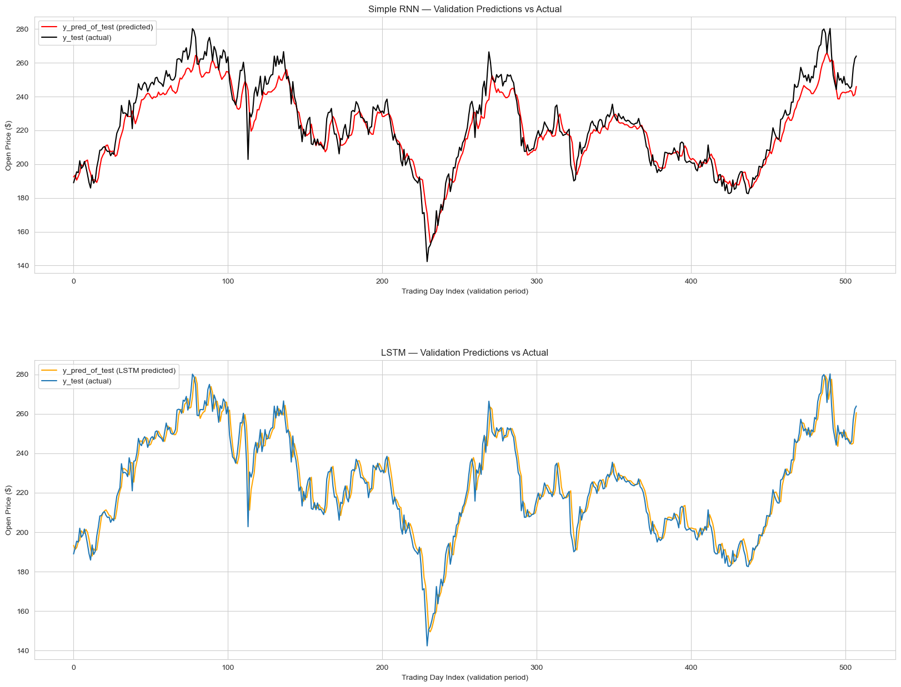

# Tesla Stock Price Forecasting with RNN and LSTM

An educational deep-learning project that compares SimpleRNN and LSTM models for one-day-ahead forecasting of Tesla's Open stock price.



> **Disclaimer:** This project is for educational purposes only. It does not provide investment, trading, or financial advice.

## Project Overview

- Uses 50 previous trading days of Tesla `Open` prices to predict the next day's `Open` price.
- Compares a stacked SimpleRNN model with a stacked LSTM model.
- Uses a chronological 70/30 train-validation split.
- Fits `MinMaxScaler` only on training data to avoid validation leakage.
- Includes notebook-ready cells for held-out MAE, RMSE, R-squared, and directional accuracy.
- Exports presentation-ready visualizations for GitHub and LinkedIn.

## Model Comparison

| Model | Architecture | Validation output |
|---|---|---|
| SimpleRNN | 4 recurrent layers, Dropout, Dense output | [Prediction chart](images/rnn_validation_prediction.png) |
| LSTM | 2 LSTM layers, Dense(32), Dense output | [Prediction chart](images/lstm_validation_prediction.png) |

The saved notebook includes visual validation results for both architectures. Numerical values are reported when the final metrics cell is run in the notebook, because validation metrics should come from the model run rather than being estimated from screenshots.

## Dataset

The project uses 1,692 daily Tesla observations spanning 2010-06-29 to 2017-03-17.

Columns:

- `Date`
- `Open`
- `High`
- `Low`
- `Close`
- `Volume`
- `Adj Close`

Only `Open` is used for forecasting. The dataset is stored locally in `data/Tesla.csv.csv` for reproducible notebook execution.

## Method

1. Sort data by date and inspect for missing or duplicate records.
2. Split the data chronologically into 70% training and 30% validation.
3. Scale the training Open prices to the 0-1 range.
4. Create overlapping 50-day input windows.
5. Train SimpleRNN and LSTM models.
6. Predict the validation period and inverse-transform predictions to dollars.
7. Compare results against a naive "previous observed Open price" baseline.

## Visualizations

| View | File |
|---|---|
| Combined RNN/LSTM prediction comparison | [rnn_lstm_validation_predictions.png](images/rnn_lstm_validation_predictions.png) |
| SimpleRNN validation prediction | [rnn_validation_prediction.png](images/rnn_validation_prediction.png) |
| LSTM validation prediction | [lstm_validation_prediction.png](images/lstm_validation_prediction.png) |
| Historical Tesla Open prices | [tesla_open_history.png](images/tesla_open_history.png) |
| RNN training fit | [rnn_training_fit.png](images/rnn_training_fit.png) |
| Full RNN timeline | [rnn_full_timeline.png](images/rnn_full_timeline.png) |
| Open-price distribution | [open_distribution.png](images/open_distribution.png) |

## Repository Structure

```text
.
|-- RNN & LSTM tesla stocks model.ipynb
|-- README.md
|-- requirements.txt
|-- data/
|   `-- Tesla.csv.csv
`-- images/
    `-- portfolio visualizations
```

## Run the Notebook

```bash
python -m venv .venv
.venv\Scripts\activate
pip install -r requirements.txt
jupyter notebook
```

Open `RNN & LSTM tesla stocks model.ipynb` and run all cells.

## Evaluation Notes

- MAE is the average absolute dollar error.
- RMSE emphasizes larger prediction errors.
- R-squared measures performance relative to a mean baseline.
- Directional accuracy measures whether the model predicts the next day's direction correctly.
- A forecast can have visually good tracking but still be unsuitable for trading.

The notebook evaluates one-step-ahead predictions using actual prior prices. It is not a realistic multi-day, walk-forward trading backtest and does not include fees, slippage, position sizing, or strategy rules.

## Suggested LinkedIn Post

> I built an RNN vs. LSTM stock-price forecasting project using historical Tesla data.
>
> The project uses 50 previous trading days to predict the next day's Open price, applies a chronological 70/30 split, and compares SimpleRNN and LSTM validation forecasts.
>
> Key takeaway: visual fit alone is not enough to establish forecasting or trading value. Any extension should include MAE, RMSE, R-squared, directional accuracy, and a simple baseline.
>
> Tools: Python, pandas, NumPy, TensorFlow/Keras, scikit-learn, Matplotlib, Seaborn, and Plotly.
>
> Educational project only; not financial advice.
> #Python #MachineLearning #DeepLearning #LSTM #RNN #DataScience #Tesla #TimeSeries
